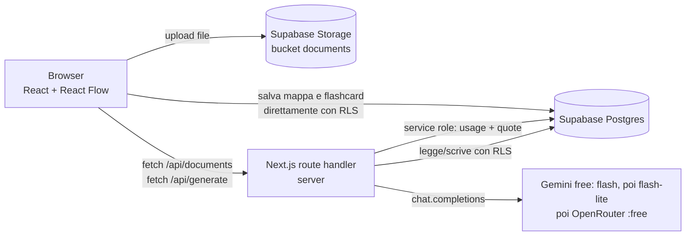
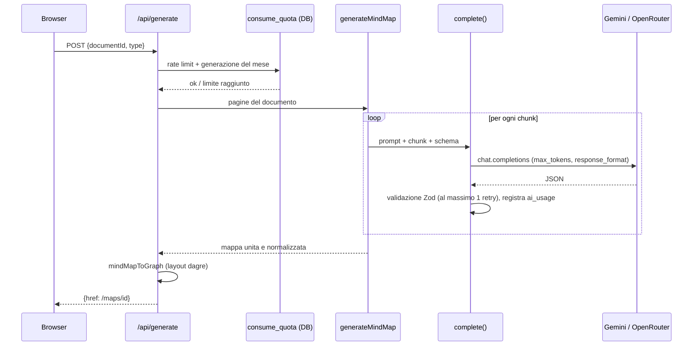

# Manuale di StudyMap

*Aggiornato al 19/10/2026: fine della Fase 1, passata a Supabase cloud senza Docker. I riferimenti `file:riga` valgono per questa versione.*

Questo manuale spiega come è fatto il progetto e soprattutto come usa l'LLM, così puoi modificarlo da sola. Il setup tecnico in inglese è nel [README.md](README.md); la specifica originale è in [docs/SPEC.md](docs/SPEC.md).

---

## 0. In una pagina

**Che cos'è.** Una web app (PWA) per chi studia all'università, in qualsiasi corso di laurea. Carichi un PDF, una foto degli appunti o del testo e ottieni:
- una **mappa concettuale** modificabile;
- un **mazzo di flashcard** da ripassare.

Ci sono due piani, free e pro, con limiti controllati dal server.

**Cosa entra → cosa esce**
- Entra: un file (PDF, PNG, JPEG, WebP) o del testo incollato.
- Esce: righe nel database. Una mappa è un grafo di nodi e archi in JSON, un mazzo è un elenco di flashcard. In più, file PNG o PDF esportati dal browser.



| Livello | Tecnologia |
|---|---|
| Linguaggio | TypeScript in modalità strict |
| Framework | Next.js 16 (App Router), React 19, Tailwind 4 |
| Database, login, file | Supabase: Postgres con RLS, Auth, Storage |
| LLM | SDK `openai` puntato su endpoint compatibili con OpenAI (oggi Google Gemini gratuito e OpenRouter; Mistral e Meta configurati ma spenti) |
| Validazione dell'output | `zod` |
| Mappe | `@xyflow/react` (React Flow) + `@dagrejs/dagre` per il layout automatico |
| PDF | `unpdf` (estrazione del testo) + `@napi-rs/canvas` (pagina → immagine) |
| Test | Vitest (unitari e test RLS/quote su un progetto Supabase di test), Playwright |
| Ambienti | Supabase **cloud** (niente Docker): un progetto di sviluppo e uno separato per i test, entrambi in UE. Deploy previsto su Vercel (non ancora fatto) |

> **RLS (Row Level Security)**: regole scritte *dentro* Postgres che dicono "questo utente vede solo le sue righe". Anche se il codice sbaglia una query, il database non restituisce dati di altri utenti.

---

## 1. Mappa del progetto

🟢 = sicuro da modificare · 🟡 = con attenzione · 🔴 = meglio non toccare senza aver capito

```
studymap/
├─ prompts/                    🟢 i prompt dell'LLM, uno per task e versione
├─ supabase/
│  ├─ config.toml              🟢 serve solo alla CLI; le impostazioni vere si fanno dalla dashboard
│  ├─ migrations/              🔴 schema del DB, RLS, bucket, funzione delle quote
├─ src/
│  ├─ config/                  🟢 I DUE FILE DI CONFIGURAZIONE (piani e modelli AI)
│  ├─ core/                    🟡 logica pura, senza Next né React: AI, limiti, ingestione, grafo
│  │  └─ ai/                   🟡 il layer AI
│  ├─ lib/                     🟡 collegamento server: client Supabase, contesto AI, helper delle API
│  ├─ app/                     🟡 pagine e API (routing di Next)
│  ├─ components/              🟢 componenti dell'interfaccia (editor mappa, flashcard, upload…)
│  └─ proxy.ts                 🔴 rinnova la sessione e protegge le pagine riservate
├─ tests/                      🟢 test su RLS e quote (tests/db) e helper per il progetto di test
├─ e2e/                        🟢 test end-to-end con Playwright
├─ public/icons/               🟢 icone della PWA
├─ .env.example                🟢 variabili d'ambiente di sviluppo
├─ .env.test.example           🟢 variabili del progetto Supabase di TEST
└─ next.config.ts              🟡 pacchetti nativi e inclusione dei prompt nel bundle
```

| File | A cosa serve | Modifica |
|---|---|---|
| [src/config/plans.ts](src/config/plans.ts) | **Tutti** i limiti free/pro e il rate limit | 🟢 |
| [src/config/ai.ts](src/config/ai.ts) | Provider, modelli, prezzi, catene di fallback, `max_tokens`, dimensione dei chunk | 🟢 |
| [prompts/mindmap.v2.md](prompts/mindmap.v2.md) | Prompt della mappa (la v1 era solo per infermieristica) | 🟢 |
| [prompts/flashcards.v2.md](prompts/flashcards.v2.md) | Prompt delle flashcard (la v1 era solo per infermieristica) | 🟢 |
| [prompts/transcribe.v1.md](prompts/transcribe.v1.md) | Prompt di trascrizione di immagini e scansioni | 🟢 |
| [src/core/ai/client.ts](src/core/ai/client.ts) | `complete()`: chiamata al modello, fallback, validazione, retry, costi | 🔴 |
| [src/core/ai/tasks.ts](src/core/ai/tasks.ts) | I tre task AI e il merge delle mappe | 🟡 |
| [src/core/ai/schemas.ts](src/core/ai/schemas.ts) | Schemi Zod dell'output dell'LLM | 🟡 |
| [src/core/ai/chunk.ts](src/core/ai/chunk.ts) | Divisione del documento in chunk | 🟡 |
| [src/core/ai/prompts.ts](src/core/ai/prompts.ts) | Carica i prompt da file e sostituisce `{{variabili}}` | 🟡 |
| [src/core/ai/mock.ts](src/core/ai/mock.ts) | Risposte finte per test e sviluppo (`AI_MOCK=1`) | 🟢 |
| [src/core/entitlements.ts](src/core/entitlements.ts) | Scelta dei modelli per piano e consenso, controlli sui limiti, messaggi | 🟡 |
| [src/core/ingest.ts](src/core/ingest.ts) | PDF o testo → array di pagine | 🟡 |
| [src/core/files.ts](src/core/files.ts) | Riconosce il tipo di file dai "magic bytes" | 🟡 |
| [src/core/graph.ts](src/core/graph.ts) | Mappa dell'LLM → grafo React Flow, layout dagre, colori | 🟢 |
| [src/lib/ai.ts](src/lib/ai.ts) | Crea il contesto AI per l'utente; quote e rate limit sul DB | 🟡 |
| [src/lib/api.ts](src/lib/api.ts) | Helper delle API: utente corrente, risposte di errore | 🟡 |
| [src/lib/supabase/server.ts](src/lib/supabase/server.ts) | Client Supabase lato server (utente e admin) | 🔴 |
| [src/lib/supabase/types.ts](src/lib/supabase/types.ts) | Tipi TypeScript delle tabelle, scritti a mano | 🟡 va aggiornato con lo schema |
| [src/app/api/documents/route.ts](src/app/api/documents/route.ts) | API di caricamento e ingestione | 🟡 |
| [src/app/api/generate/route.ts](src/app/api/generate/route.ts) | API di generazione di mappa e flashcard | 🟡 |
| [src/app/api/account/route.ts](src/app/api/account/route.ts) | Cancellazione dell'account | 🔴 |
| [src/components/MapEditor.tsx](src/components/MapEditor.tsx) | Editor della mappa, autosave, export | 🟡 |
| [src/components/FlashcardReview.tsx](src/components/FlashcardReview.tsx) | Ripasso "so / non so" | 🟢 |
| [src/components/UploadForm.tsx](src/components/UploadForm.tsx) | Form di caricamento | 🟢 |
| [supabase/migrations/20261019000000_init.sql](supabase/migrations/20261019000000_init.sql) | Tutto lo schema del DB | 🔴 crea una nuova migrazione, non modificarla |

**Da dove parte l'esecuzione.** Non c'è un `main`. Next.js associa le URL ai file in `src/app`:
- `src/app/(app)/library/page.tsx` è la pagina `/library`;
- `src/app/api/generate/route.ts` è l'endpoint `POST /api/generate`.

Le parentesi in `(app)` raggruppano delle pagine senza comparire nella URL. Prima di ogni richiesta gira [src/proxy.ts](src/proxy.ts) (in Next 16 il vecchio "middleware" si chiama "proxy").

---

## 2. Come funziona, passo per passo: "carico un PDF → ottengo la mappa"

### Fase A: caricamento e ingestione

1. **Form.** In `/library` compili [UploadForm.tsx](src/components/UploadForm.tsx). Il browser controlla tipo e dimensione solo per l'esperienza d'uso: il controllo vero è sul server.
2. **Upload diretto su Storage.** [UploadForm.tsx:57](src/components/UploadForm.tsx:57) carica il file in `documents/{tuo-user-id}/{uuid}.pdf` con il client Supabase del browser. Le policy RLS sullo storage ([migrazione:147-152](supabase/migrations/20261019000000_init.sql:147)) permettono di scrivere solo nella tua cartella.
   *Perché non passa da Next?* Le funzioni serverless (Vercel) accettano richieste fino a circa 4,5 MB, e un PDF di 200 pagine può pesare di più.
3. **Chiamata all'API.** [UploadForm.tsx:24](src/components/UploadForm.tsx:24) chiama `POST /api/documents` con `{kind:"file", title, storagePath}`.
4. **Utente e limiti.** In [documents/route.ts:19](src/app/api/documents/route.ts:19):
   - `apiUser()` legge la sessione;
   - lo schema Zod `Body` valida la richiesta;
   - `canSaveDocument` ([:29](src/app/api/documents/route.ts:29)) controlla il numero di documenti salvati.
5. **Validazione del file.** La route scarica il file e controlla:
   - la dimensione per piano (`checkUploadSize`);
   - il tipo reale dai primi byte con `detectFileKind` ([:56](src/app/api/documents/route.ts:56)).

   Se qualcosa non va, il file viene cancellato (`removeUpload`).
6. **Rate limit e tetto di token.** `guardAi` ([lib/ai.ts:66](src/lib/ai.ts:66)) serve perché l'ingestione può chiamare l'LLM per le pagine scansionate.
7. **Estrazione del testo.** `ingestPdf` ([ingest.ts:13](src/core/ingest.ts:13)):
   - rifiuta subito i PDF oltre il limite di pagine (`PageLimitError`);
   - estrae il testo pagina per pagina con `unpdf`;
   - le pagine con meno di 50 caratteri (`MIN_PAGE_CHARS`) sono probabilmente scansioni: vengono trasformate in immagine PNG e trascritte dall'LLM con `transcribeImage`.

   Le immagini caricate vanno direttamente alla trascrizione ([route.ts:75](src/app/api/documents/route.ts:75)).
8. **Salvataggio.** Il documento viene salvato in `documents` con `pages` (array di testi, uno per pagina). Il browser va su `/documents/{id}`.

### Fase B: generazione della mappa

9. **Clic.** Premi "Genera mappa concettuale" in [GenerateButtons.tsx:18](src/components/GenerateButtons.tsx:18), che chiama `POST /api/generate` con `{documentId, type:"mindmap"}`.
10. **Controlli.** In [generate/route.ts:15](src/app/api/generate/route.ts:15):
    - carica il documento (la RLS garantisce che sia tuo);
    - `guardAi` controlla il rate limit e il tetto di token;
    - `consumeQuota(..., "generation", ...)` ([:32](src/app/api/generate/route.ts:32)) consuma una generazione del mese. Se sei al limite risponde 402 con `upgrade: true` e la UI mostra `UpgradeNotice`.
11. **Contesto AI.** `aiContextFor(profile)` ([lib/ai.ts:20](src/lib/ai.ts:20)) sceglie i modelli in base a piano e consenso e prepara la funzione che registra i consumi.
12. **Generazione.** `generateMindMap` ([tasks.ts:23](src/core/ai/tasks.ts:23)):
    - divide le pagine in chunk (`chunkPages`);
    - per ogni chunk chiama `complete()` con il prompt `mindmap.v2.md`;
    - unisce i risultati con `mergeMindMaps`.
13. **Dall'output dell'LLM al grafo.** `mindMapToGraph` ([graph.ts:34](src/core/graph.ts:34)) trasforma l'elenco dei nodi `{id,label,parentId,relation}` in nodi e archi di React Flow, con colori per livello e posizioni calcolate da dagre.
14. **Salvataggio della mappa.** Il grafo va in `maps.graph` ([route.ts:43](src/app/api/generate/route.ts:43)). Se qualcosa fallisce, la generazione viene **restituita** alla quota ([:66](src/app/api/generate/route.ts:66)).
15. **Editor.** Il browser va su `/maps/{id}`, dove [MapEditor.tsx](src/components/MapEditor.tsx) mostra il grafo. Ogni modifica viene salvata direttamente sul DB dopo 800 ms di inattività ([MapEditor.tsx:147](src/components/MapEditor.tsx:147)), protetta dalla RLS.



Le flashcard seguono lo stesso percorso, con `generateFlashcards` ([tasks.ts:91](src/core/ai/tasks.ts:91)) e il salvataggio in `decks` + `flashcards`.

---

## 3. Come viene usato l'LLM

### 3.1 Il principio: un solo client, i provider in configurazione

La specifica proponeva un'interfaccia `AIProvider` con 6 metodi da implementare per ogni provider. Si è scelto un approccio più semplice:

- **[config/ai.ts](src/config/ai.ts)** descrive *dove* e *con cosa* chiamare: provider, modelli, catene.
- **[client.ts](src/core/ai/client.ts) → `complete()`** sa *come* chiamare qualunque modello compatibile con OpenAI, con fallback, validazione e costi.
- **[tasks.ts](src/core/ai/tasks.ts)** sa *cosa* chiedere: prompt, chunking, merge.

*Perché.* Tutti i provider usati parlano lo stesso protocollo (`/v1/chat/completions`) e cambiano solo URL, nome del modello e prezzo. Con un'interfaccia per provider avresti dovuto riscrivere prompt e parsing per ognuno.

*Limite.* Un provider **non** compatibile con OpenAI (per esempio l'SDK nativo di Anthropic) richiede una seconda funzione con la stessa firma di `ChatFn` ([client.ts:18](src/core/ai/client.ts:18)).

### 3.2 Scelta del modello: per piano e per consenso

[config/ai.ts:76](src/config/ai.ts:76):
```ts
export const CHAINS = {
  free: ["muse-spark-contributor", "mistral-small", "gemini-flash", "gemini-flash-lite", "openrouter-free"],
  pro:  ["muse-spark",             "mistral-small", "gemini-flash", "gemini-flash-lite", "openrouter-free"],
};
```
`modelChain()` ([entitlements.ts:9](src/core/entitlements.ts:9)) parte dalla catena del piano e **toglie**:
1. i modelli con `enabled: false` (oggi i due Meta);
2. i modelli con `usesDataForTraining: true` se l'utente **non** ha dato il consenso (oggi `openrouter-free`);
3. per la trascrizione, i modelli senza `vision`;
4. i modelli senza chiave API nell'ambiente (`hasKey`, [lib/ai.ts:18](src/lib/ai.ts:18)).

Risultato oggi:

| Utente | Catena testo | Catena visione |
|---|---|---|
| senza consenso | nessuno: l'app risponde "Nessun modello AI disponibile" | nessuno |
| con consenso | Gemini Flash → Gemini Flash-Lite → OpenRouter free | Gemini Flash → Gemini Flash-Lite |

*Perché così.* Mistral ha tolto il piano API gratuito, quindi `mistral-small` è spento (`enabled: false`) con i suoi prezzi reali. Il piano gratuito di Gemini può usare i dati per il training, quindi è marcato `usesDataForTraining: true` e funziona solo con il consenso. In più le condizioni di Google non permettono il piano gratuito per app usate da utenti in UE: va bene per sviluppare, non per la produzione. Per andare in produzione: attivi un modello a pagamento che non usa i dati (per esempio Mistral con un tetto di spesa), metti `enabled: true` e lo lasci primo nella catena.

Il consenso è la colonna `profiles.ai_data_sharing_consent_at`, che l'utente attiva o revoca in `/settings` ([AccountActions.tsx](src/components/AccountActions.tsx)).

### 3.3 Le tre chiamate al modello

#### a) Mappa concettuale: `generateMindMap`
- **Dove**: [tasks.ts:23](src/core/ai/tasks.ts:23), chiamata da [generate/route.ts:40](src/app/api/generate/route.ts:40).
- **Scopo**: estrarre concetti e relazioni dal testo e organizzarli in un albero.
- **Modello**: la catena del §3.2.
- **Prompt**:
  - *system* = [mindmap.v2.md](prompts/mindmap.v2.md): ruolo di tutor universitario per qualsiasi corso di laurea, regole (italiano, terminologia della disciplina riconosciuta dal materiale, termini e formule lasciati com'erano, niente dati inventati, una sola radice, massimo 40 nodi e 4 livelli, etichette brevi), `{{title}}` e `{{schema}}` (lo schema JSON generato da Zod);
  - *user* = il testo del chunk, con i marcatori `[Pagina N]`.
- **Output**: `MindMapSchema` ([schemas.ts:3](src/core/ai/schemas.ts:3)), cioè un elenco **piatto** di nodi `{id, label, parentId, relation}`.
  *Perché piatto e non ad albero annidato?* Gli schemi ricorsivi non sono accettati da tutti i provider (Meta li vieta) e confondono di più il modello. `parentId` basta a ricostruire l'albero.
- **Post-elaborazione**: `normalizeMindMap` ([tasks.ts:43](src/core/ai/tasks.ts:43)) ripara gli errori tipici dell'LLM: id duplicati, `parentId` che puntano a nodi inesistenti, cicli, più radici (aggiunge una radice con il titolo del documento). Con più chunk, `mergeMindMaps` ([:76](src/core/ai/tasks.ts:76)) mette ogni sotto-mappa sotto una radice comune e rinomina gli id (`c0_n1`, `c1_n1`…) per evitare collisioni, **senza** una chiamata LLM in più.

#### b) Flashcard: `generateFlashcards`
- **Dove**: [tasks.ts:91](src/core/ai/tasks.ts:91).
- **Prompt**: [flashcards.v2.md](prompts/flashcards.v2.md), con domanda su un solo concetto, risposta in massimo 3 frasi e tra 8 e 25 carte per chunk.
- **Output**: `FlashcardsSchema` ([schemas.ts:18](src/core/ai/schemas.ts:18)), cioè `{cards: [{front, back}]}`.
- **Post-elaborazione**: le carte di tutti i chunk vengono concatenate, deduplicate con `dedupeCards` (confronto sulla domanda normalizzata: minuscole, senza punteggiatura) e tagliate a 60.

#### c) Trascrizione di immagini e scansioni: `transcribeImage`
- **Dove**: [tasks.ts:121](src/core/ai/tasks.ts:121), chiamata durante l'ingestione.
- **Input**: un messaggio *user* con un'immagine `image_url` in formato `data:image/png;base64,...`.
- **Prompt**: [transcribe.v1.md](prompts/transcribe.v1.md), cioè trascrizione fedele in Markdown, `[illeggibile]` dove serve e descrizione delle figure.
- **Modello**: la catena *visione* (`vision: true`).
- **Costi**: registra `ocr_pages = 1` per pagina trascritta.
- *Perché non Mistral OCR?* È a pagamento (circa 4 $ ogni 1000 pagine) e ha un endpoint diverso. Con un modello multimodale gratuito il costo è zero; Mistral OCR si può aggiungere se la qualità non basta.

### 3.4 Parametri di generazione

Sono in [client.ts:66-75](src/core/ai/client.ts:66).

| Parametro | Valore | Perché |
|---|---|---|
| `temperature` | `0.3` | Compiti di estrazione: serve fedeltà al testo, non creatività. Valori più alti danno mappe più varie ma con più invenzioni. |
| `max_tokens` | da `TASKS` in [ai.ts:83](src/config/ai.ts:83): 4000 per mappa e flashcard, 3000 per la trascrizione | Limita la lunghezza e il costo della risposta. Se è troppo basso il JSON viene troncato e la validazione fallisce. |
| `response_format` | `json_schema` (Mistral) o `json_object` (Gemini, OpenRouter: l'endpoint di Gemini rifiuta i nostri schemi in modalità `json_schema`, verificato il 19/10/2026), dal campo `structuredOutput` del modello | Obbliga il modello a rispondere in JSON. |
| `timeout` | 90 s (`REQUEST_TIMEOUT_MS`) | Oltre questo tempo la chiamata conta come fallita e si passa al modello successivo. |
| `maxRetries` | `0` nell'SDK | I retry li gestisce `complete()` cambiando modello. |

### 3.5 Output strutturato, validazione e retry

Tutto avviene in `complete()` ([client.ts:102](src/core/ai/client.ts:102)):

1. Lo schema Zod diventa JSON Schema (`z.toJSONSchema`, [:113](src/core/ai/client.ts:113)). Viene inviato nel `response_format` e, tramite `{{schema}}`, anche dentro il prompt: così funziona anche con i provider che supportano solo `json_object`.
2. La risposta passa da `parseJsonOutput` ([:97](src/core/ai/client.ts:97)), che toglie eventuali blocchi ```json, e poi da `schema.safeParse`.
3. **Se non è valida**: si aggiungono alla conversazione la risposta sbagliata e un messaggio con l'errore di validazione ([:166](src/core/ai/client.ts:166)), poi si riprova **una volta** con lo stesso modello.
4. Se fallisce di nuovo si passa al **modello successivo** della catena.

### 3.6 Fallback, errori e rate limit

`shouldFallback` ([client.ts:91](src/core/ai/client.ts:91)) decide quando passare al modello successivo:

- **sì**: con 429 (rate limit), 5xx, timeout o errori di rete (status assente), 401/403 (chiave sbagliata) e output non valido dopo il retry;
- **no**: con 400, 404 e 422. Indicano un errore nella richiesta: cambiare modello non aiuterebbe e nasconderebbe il bug.

Prima di cambiare modello, se l'errore è 429 o 5xx (modello "occupato", tipico dei piani gratuiti), si riprova **sullo stesso modello** dopo 2 e poi 5 secondi (`RETRY_DELAYS_MS` in [config/ai.ts](src/config/ai.ts)). Ogni tentativo fallito resta registrato in `ai_usage`. Timeout ed errori di rete passano subito al modello successivo, senza attesa.

Se tutta la catena fallisce, `complete()` lancia `AiUnavailableError` ("servizio momentaneamente occupato") e l'API risponde 503.

Rate limit *dell'app*: al massimo `RATE_LIMITS.aiRequestsPerMinute` (5) richieste AI al minuto per utente, contate in `quota_counters` con `kind = "rl:ai"` ([lib/ai.ts:66](src/lib/ai.ts:66)).

### 3.7 Chunking

[chunk.ts:5](src/core/ai/chunk.ts:5):
- le pagine vengono unite in blocchi fino a `CHUNK_INPUT_TOKENS` (12.000 token stimati, [ai.ts:89](src/config/ai.ts:89));
- i token si stimano come caratteri / 4, un'approssimazione che per l'italiano è un po' ottimistica;
- una pagina enorme viene spezzata;
- le pagine vuote vengono saltate;
- ogni pagina porta il marcatore `[Pagina N]`, che servirà in Fase 2 per citare le pagine nella chat.

I chunk vengono elaborati **in sequenza**, non in parallelo, per non superare i limiti di richieste al minuto dei piani gratuiti.

### 3.8 Tracciamento dei costi

Ogni tentativo, riuscito o fallito, chiama `ctx.record()` e scrive una riga in `ai_usage` ([lib/ai.ts:28](src/lib/ai.ts:28)) con:
- task, provider, modello, `prompt_version`;
- token in input e output, `ocr_pages`;
- `cost_usd`, calcolato da `costUsd` ([client.ts:87](src/core/ai/client.ts:87)) con i prezzi in `MODELS`;
- `ok` ed `error`.

I token in input vengono anche sommati in `quota_counters` (`kind = "input_tokens"`) per il tetto mensile.

> Oggi i prezzi in config sono **0** perché i piani usati sono gratuiti. I token però vengono registrati: quando passerai a un modello a pagamento basta mettere il prezzo in `MODELS` e il margine per utente si calcola subito (query nel README).

### 3.9 RAG, embedding, tool calling, streaming, caching
Non presenti in questo progetto: niente database vettoriale, niente tool o function calling, niente streaming né prompt caching. Il modello riceve il testo del chunk direttamente nel prompt.

### 3.10 Limiti noti e rischi
- **Allucinazioni.** Il prompt vieta di inventare dosaggi e valori, ma niente lo verifica automaticamente. In ambito sanitario è il rischio principale.
- **Prompt injection.** Un PDF può contenere testo come "ignora le istruzioni…". Il danno è limitato: l'output deve comunque rispettare lo schema Zod e il modello non ha tool.
- **Dati sensibili.** Tutto il testo del documento va al provider. Per questo ci sono l'avviso di non caricare dati di pazienti reali e il consenso separato per i provider che usano i dati per il training.
- **Dipendenza dai piani gratuiti.** Possono cambiare o sparire. La catena di fallback e la configurazione rendono il cambio veloce.

### 3.11 Tabella riassuntiva

| Funzione | File | Scopo | Modelli | Tool | Output strutturato |
|---|---|---|---|---|---|
| `generateMindMap` | [tasks.ts:23](src/core/ai/tasks.ts:23) | mappa concettuale | catena testo | no | sì (`MindMapSchema`) |
| `generateFlashcards` | [tasks.ts:91](src/core/ai/tasks.ts:91) | flashcard | catena testo | no | sì (`FlashcardsSchema`) |
| `transcribeImage` | [tasks.ts:121](src/core/ai/tasks.ts:121) | trascrizione di immagini e scansioni | catena visione | no | sì (`TranscriptionSchema`) |

### 3.12 Mini-corso, con gli esempi di questo progetto
- **Token e finestra di contesto.** Il modello legge e scrive "pezzi" di parola. Gemini Flash accetta circa 1 milione di token, ma noi mandiamo blocchi da circa 12k: risposte più focalizzate, meno costi e un rischio minore di dimenticare il centro del testo.
- **System prompt.** È il messaggio con il ruolo e le regole (i file in `prompts/`). Il testo dello studente va nel messaggio *user*, così le regole restano separate dal contenuto.
- **Temperature.** È la "casualità" della risposta. A 0.3 la stessa pagina produce mappe simili tra un tentativo e l'altro.
- **Structured output.** Si chiede al modello di rispettare uno schema JSON (`response_format`). Non è garantito al 100%, per questo c'è anche la validazione Zod con retry.
- **Multimodalità.** Lo stesso endpoint accetta immagini nel messaggio (`image_url`). La usiamo per leggere appunti fotografati.
- **Fallback.** Se un modello è occupato (429) se ne prova un altro. È la difesa principale quando si usano piani gratuiti.

---

## 4. Configurazione e avvio

### Variabili d'ambiente
L'elenco completo è in [.env.example](.env.example). Copialo in `.env.local`, che git ignora.

| Variabile | Obbligatoria | Letta in | Scopo |
|---|---|---|---|
| `NEXT_PUBLIC_SUPABASE_URL` | sì | `lib/supabase/*`, `proxy.ts` | URL di Supabase |
| `NEXT_PUBLIC_SUPABASE_ANON_KEY` | sì | come sopra | chiave pubblica (vale la RLS) |
| `SUPABASE_SERVICE_ROLE_KEY` | sì | [server.ts:28](src/lib/supabase/server.ts:28) | scrive consumi e quote, cancella gli account. **Solo server** |
| `MISTRAL_API_KEY` | sì (senza mock) | via `PROVIDERS` in `config/ai.ts` | provider primario |
| `OPENROUTER_API_KEY` | no | come sopra | riserva |
| `META_API_KEY` | no | come sopra | modelli Meta (spenti) |
| `AI_MOCK` | no | [lib/ai.ts:17](src/lib/ai.ts:17) | `1` = risposte finte, ignorato in produzione |

### Avvio (Supabase cloud, niente Docker)
I passi completi, con i percorsi della dashboard, sono nel [README](README.md#setup). In breve:
1. Su supabase.com crea un progetto in regione UE (per esempio Francoforte).
2. Collega il repo al progetto e applica le migrazioni:
   ```bash
   npx supabase login
   ```
   ```bash
   npx supabase link --project-ref <project-ref>
   ```
   ```bash
   npm run db:push
   ```
3. Copia URL e chiavi da **Project Settings → API** in `.env.local`.
4. In **Authentication → URL Configuration** aggiungi `http://localhost:3000/auth/callback` ai Redirect URLs.
5. Configura Google in **Authentication → Sign In / Providers → Google**.
6. Avvia l'app:
   ```bash
   npm run dev
   ```

**Email di conferma.** Sul cloud sono attive di default: dopo la registrazione l'utente deve cliccare il link nell'email (la UI mostra "Controlla la tua email"). Il servizio email incluso in Supabase serve solo per le prove: ha limiti molto bassi e può consegnare solo agli indirizzi del team del progetto. Prima di aprire l'app agli studenti configura un SMTP tuo in **Authentication → Emails → SMTP Settings**.

### Test
```bash
npm test
```
33 test unitari, senza rete e senza modelli reali. Verificati: passano.
```bash
npm run test:db
```
Test Vitest su RLS, storage e quote, contro il progetto Supabase di **test**: [tests/db/rls-and-quota.test.ts](tests/db/rls-and-quota.test.ts). Verificato il 19/10/2026: 7 test passano.
```bash
npm run test:e2e
```
Playwright: login → PDF → mappa → rinomina → ricarica, con AI finta, contro il progetto di **test**. Verificato il 19/10/2026: passa in circa 25 secondi e alla fine il progetto di test resta vuoto.

**Perché un secondo progetto Supabase.** Questi test creano e cancellano utenti veri. Farli girare sul progetto di sviluppo sporcherebbe i tuoi dati, quindi usano `.env.test` (copialo da [.env.test.example](.env.test.example)). [tests/test-env.ts](tests/test-env.ts) si rifiuta di partire se `.env.test` manca o punta allo stesso URL di `.env.local`, e forza sempre `AI_MOCK=1`. Gli utenti di test nascono già confermati tramite l'API admin e vengono cancellati alla fine.

I vecchi test pgTAP (SQL) sono stati convertiti in Vitest: pgTAP sul cloud richiede di collegarsi direttamente al database, mentre il client Supabase con due utenti veri verifica la RLS come la vede l'app.

```bash
npm run lint
```
```bash
npm run typecheck
```

---

## 5. Dati e stato

| Dove | Cosa | Se lo cancelli |
|---|---|---|
| `profiles` | piano (`free`/`pro`), consenso AI, data dell'esame, `preferences` (stile, carattere, dimensione, spaziatura) | si ricrea solo con un nuovo login |
| `folders` | materie (cartelle senza `parent_id`) e sottocartelle, con colore, icona, ordine | si elimina solo se vuota |
| `notes` | appunti dell'utente (testo semplice, max 100.000 caratteri) dentro una cartella | perdi l'appunto |
| `documents` | titolo, tipo, `pages` (testo estratto), percorso del file | perdi il documento; mappe e flashcard restano (`document_id` diventa null) |
| Storage `documents/{uid}/` | il file originale | il documento resta, il file no |
| `maps.graph` | nodi e archi della mappa (JSON) | perdi la mappa |
| `decks` + `flashcards` | mazzi, carte, ultimo esito del ripasso | perdi il mazzo |
| `ai_usage` | log di ogni chiamata LLM e del suo costo | perdi lo storico dei costi |
| `quota_counters` | contatori per periodo: `generation` (mese), `input_tokens` (mese), `rl:ai` (minuto) | si azzerano i limiti |

Ogni documento, mappa, mazzo e appunto ha un `folder_id` obbligatorio. Cartelle e contenuti sono descritti in [supabase/migrations/20261020000000_folders.sql](supabase/migrations/20261020000000_folders.sql):
- la chiave esterna è composta, `(folder_id, user_id) → folders(id, user_id)`: il database rifiuta un contenuto nella cartella di un altro utente e l'eliminazione di una cartella che contiene qualcosa;
- il trigger `check_folder_tree` rifiuta oltre 3 livelli e le cartelle dentro sé stesse;
- `default_folder_id()` è il valore predefinito di `folder_id` (la prima materia dell'utente), così gli insert che non lo indicano finiscono lì;
- ogni nuovo utente riceve la materia "Generale" (in `handle_new_user`); i dati presenti prima della migrazione sono finiti nella "Generale" di ciascuno;
- `move_document(documento, cartella)` sposta il documento insieme alle mappe e ai mazzi generati da lui.

Lo schema iniziale è in [supabase/migrations/20261019000000_init.sql](supabase/migrations/20261019000000_init.sql). Punti chiave:
- `plan` non è modificabile dal browser: [righe 100-101](supabase/migrations/20261019000000_init.sql:100) concedono all'utente solo la colonna del consenso;
- `ai_usage` e `quota_counters` sono in sola lettura per l'utente ([:118](supabase/migrations/20261019000000_init.sql:118));
- `consume_quota` ([:120](supabase/migrations/20261019000000_init.sql:120)) incrementa il contatore solo se resta entro il limite, in un'unica istruzione, così due richieste simultanee non lo superano. Può chiamarla solo il server (`service_role`).

---

## 6. Ricettario delle modifiche

**1. Cambiare i limiti di un piano**
- **Dove**: [src/config/plans.ts](src/config/plans.ts), per esempio `generationsPerMonth`, `maxPdfPages`, `maxDocuments`. `Infinity` significa illimitato.
- **Verifica**: `npm test`. Il test `entitlements.test.ts` usa i valori della config, quindi resta valido. La tabella in `/settings` si aggiorna da sola.
- **Cosa può rompersi**: niente, se rispetti i tipi.

**2. Cambiare il testo di un prompt**
- **Dove**: crea `prompts/mindmap.v2.md` copiando la v1, modificala e poi in [config/ai.ts:83](src/config/ai.ts:83) metti `mindmap: { promptVersion: "v2", ... }`.
- **Verifica**: genera una mappa e guarda in `ai_usage` che `prompt_version = 'v2'`.
- **Cosa può rompersi**: se togli `{{schema}}` dal prompt, i provider in modalità `json_object` non sanno più che forma dare al JSON.

**3. Cambiare modello primario o provider**
- **Dove**: [config/ai.ts](src/config/ai.ts). Per attivare Meta: `enabled: true` su `muse-spark` e la chiave `META_API_KEY`. Per cambiare l'ordine modifica `CHAINS`.
- **Verifica**: `npm test`. Il test "excludes models that train on data" fallisce se attivi il contributor: è voluto, aggiorna il test.
- **Cosa può rompersi**: un modello senza `json_schema`. In quel caso usa `structuredOutput: "json_object"`.

**4. Aggiungere un provider compatibile con OpenAI (es. Gemini a pagamento)**
- **Dove**:
  - in `PROVIDERS` aggiungi `gemini: { baseURL: "...", apiKeyEnv: "GEMINI_API_KEY" }`;
  - in `MODELS` aggiungi il modello con i prezzi;
  - in `CHAINS` aggiungi la sua `key`;
  - in `.env.example` aggiungi la variabile.
- **Verifica**: con la chiave impostata, genera una mappa e controlla `ai_usage.provider`.

**5. Cambiare temperature o max_tokens**
- **Dove**: `max_tokens` in `TASKS` ([ai.ts:83](src/config/ai.ts:83)); `temperature` in [client.ts:70](src/core/ai/client.ts:70), uguale per tutti i task.
- **Cosa può rompersi**: con `max_tokens` troppo basso il JSON si tronca. Nel log `ai_usage.error` compare un errore di parsing.

**6. Aggiungere un campo all'output (es. una "spiegazione" per ogni flashcard)**
- **Dove**:
  1. `FlashcardsSchema` in [schemas.ts:18](src/core/ai/schemas.ts:18), per esempio `explanation: z.string().nullable()`;
  2. una nuova migrazione SQL con la colonna;
  3. `FlashcardRow` in [types.ts](src/lib/supabase/types.ts);
  4. l'insert in [generate/route.ts:59](src/app/api/generate/route.ts:59);
  5. la visualizzazione in `FlashcardReview.tsx`;
  6. aggiorna il mock in [mock.ts](src/core/ai/mock.ts).
- **Verifica**: `npm test` e `npm run typecheck`.

**7. Cambiare la dimensione dei chunk**
- **Dove**: `CHUNK_INPUT_TOKENS` in [ai.ts:89](src/config/ai.ts:89).
- **Effetto**: chunk più grandi significano meno chiamate e una mappa più "globale", ma per i documenti lunghi output più lunghi e il rischio di superare `max_tokens`.

**8. Cambiare la soglia che distingue una pagina scansionata**
- **Dove**: `MIN_PAGE_CHARS` in [ingest.ts:3](src/core/ingest.ts:3).
- **Effetto**: alzandola, più pagine vanno al modello con visione (più lento, consuma quota).

**9. Modificare lo schema del database**
- **Come**: **non** modificare la migrazione esistente. Crea un nuovo file `supabase/migrations/AAAAMMGGhhmmss_descrizione.sql`, poi aggiorna `src/lib/supabase/types.ts`.
- **Verifica**: `npm run db:push` sul progetto di test (collegato con `npx supabase link`), poi `npm run test:db`; infine `db:push` sul progetto di sviluppo. Ogni nuova tabella deve avere `enable row level security` e le sue policy.

**10. Cambiare il rate limit**
- **Dove**: `RATE_LIMITS.aiRequestsPerMinute` in [plans.ts:42](src/config/plans.ts:42).

**11. Cambiare i colori o il layout della mappa**
- **Colori**: nella mappa ogni nodo salva un ruolo (`radice`, `area-1`, `area-2`, `area-3`, `neutro`), non un colore. Il colore di ogni ruolo è nei token `--node-<ruolo>` e `--node-<ruolo>-ink` di [globals.css](src/app/globals.css), uno per stile e per tema. Le mappe salvate prima con colori esadecimali si convertono con `LEGACY_HEX` in [graph.ts](src/core/graph.ts).
- **Layout**: i parametri di dagre (`rankdir: "TB"` dall'alto in basso, `"LR"` da sinistra a destra) in [graph.ts](src/core/graph.ts).
- **Verifica**: `graph.test.ts` controlla che i livelli vadano dall'alto in basso. Se passi a `"LR"`, aggiornalo.

**12. Registrare altro nei log dei costi**
- **Dove**: il tipo `UsageRecord` in [client.ts](src/core/ai/client.ts), le due chiamate a `ctx.record` in `complete()`, l'insert in [lib/ai.ts:28](src/lib/ai.ts:28) e una migrazione con la nuova colonna.

---

**13. Cambiare colori, caratteri o stile dei componenti**
- **I temi**: l'app ha due temi, Classic (predefinito) e Vivid, ognuno con versione chiara e scura. Nel codice si chiamano ancora `corsia` ed `evidenziatore`: i nomi visibili sono in `APP_STYLES` di [styles.ts](src/config/styles.ts), quindi per rinominarli basta cambiare `name` lì. Il tema scelto sta nel profilo e nel cookie `studymap-style`; il server lo scrive in `<html data-style="…">`, così la pagina si apre già nello stile giusto.
- **Dove**: i token di ogni stile (colori, colori dei nodi, caratteri) sono nei blocchi `[data-style="corsia"]` e `[data-style="evidenziatore"]` di [src/app/globals.css](src/app/globals.css), con le varianti scure nel blocco `prefers-color-scheme: dark`. Forma dei nodi e archi: le regole `.concept-node` nello stesso file e `edgeType` in [MapEditor.tsx](src/components/MapEditor.tsx). Nomi e descrizioni degli stili: [src/config/styles.ts](src/config/styles.ts). Caratteri: [src/app/layout.tsx](src/app/layout.tsx).
- **Aggiungere uno stile**: una voce in `APP_STYLES`, un blocco `[data-style="…"]` chiaro e uno scuro con tutti i token.
- **Verifica**: `npm test` esegue `tokens.test.ts`, che controlla il contrasto WCAG AA (almeno 4,5:1) di testo, pulsanti e nodi in tutti gli stili, chiari e scuri.
- **Cosa può rompersi**: un token mancante in un blocco (il test lo segnala) o un colore con contrasto troppo basso.

**13b. Cambiare il dock della home**
- **Dove**: i riquadri sono in [StudyDock.tsx](src/components/StudyDock.tsx), il timer in [StudyTimer.tsx](src/components/StudyTimer.tsx) (durata in `SESSION_SECONDS`), i dati si calcolano in `loadStudy` di [src/lib/workspace.ts](src/lib/workspace.ts) (per tutta la libreria o per una materia). I colori sono i token `--dock-*` di [globals.css](src/app/globals.css), uno per stile.
- **Carte da ripassare**: oggi sono le carte segnate "non so" più quelle mai ripassate. Con la ripetizione dilazionata (Fase 2) diventeranno le carte in scadenza oggi.
- **Data dell'esame**: colonna `profiles.exam_date`, scrivibile dal client (migrazione `20261019000200_exam_date.sql`); si imposta in Impostazioni → Esame.
- **Verifica**: `tokens.test.ts` controlla il contrasto del testo sui riquadri; `dates.test.ts` il conto dei giorni.

**13c. Materie, cartelle e appunti**
- **Pagine**: la libreria ([library/page.tsx](src/app/(app)/library/page.tsx)) mostra le materie; [folders/[id]/page.tsx](src/app/(app)/folders/[id]/page.tsx) è la stessa pagina per materie e sottocartelle (il dock compare solo nella materia e conta tutto l'albero); [notes/[id]/page.tsx](src/app/(app)/notes/[id]/page.tsx) è l'editor degli appunti.
- **Logica dell'albero** (pura, testata in `folders.test.ts`): [src/core/folders.ts](src/core/folders.ts), con `MAX_FOLDER_DEPTH`. Se cambi la profondità, cambia anche il `3` nel trigger della migrazione.
- **Letture dal database**: [src/lib/workspace.ts](src/lib/workspace.ts) (cartelle, dati del dock, ricerca con `ilike`).
- **Pulsanti e moduli**: [FolderControls.tsx](src/components/FolderControls.tsx). `FolderGrid` disegna le cartelle grandi (forma in `.folder-card` di globals.css), il riquadro "+" per crearne una, l'ordinamento Data/Nome/Personale (non salvato: torna a Personale ricaricando) e il menu "⋯" (sposta prima/dopo, personalizza). `FolderSettings` gestisce nome, colore, icona, spostamento ed eliminazione; `MoveToFolder` è il menu "Cartella" nelle pagine dei contenuti; [NoteEditor.tsx](src/components/NoteEditor.tsx) salva da solo dopo 800 ms, come l'editor della mappa.
- **Appunti e generazione**: in Carica, "Testo o appunti" crea un appunto (tabella `notes`), non un documento. Dalla pagina dell'appunto si generano mappa e flashcard: [api/generate](src/app/api/generate/route.ts) accetta `documentId` oppure `noteId` e usa il testo salvato. Mappa e mazzo finiscono nella cartella dell'appunto, con `document_id` vuoto. I vecchi testi caricati prima di questa modifica restano documenti.
- **Limite delle materie**: `maxSubjects` in [plans.ts](src/config/plans.ts), controllato in [api/folders/route.ts](src/app/api/folders/route.ts). Le sottocartelle non contano.
- **Colori e icone delle cartelle**: `FOLDER_COLORS` e `FOLDER_ICONS` in [styles.ts](src/config/styles.ts); i colori `--folder-1…6` in [globals.css](src/app/globals.css) riusano i token dei nodi, quindi seguono lo stile e il tema scuro. Un'icona nuova va aggiunta anche in [icons.tsx](src/components/icons.tsx) e nel `check` della migrazione.
- **Verifica**: `npm test`, `npm run test:db` (`tests/db/folders.test.ts`), `npm run test:e2e` (`e2e/folders.spec.ts`).

**13d. Preferenze del workspace (stile, carattere, dimensione, spaziatura)**
- **Dove**: le opzioni sono in [styles.ts](src/config/styles.ts), la lettura con valori di riserva in [src/core/preferences.ts](src/core/preferences.ts), il pannello in [StyleSwitch.tsx](src/components/StyleSwitch.tsx).
- **Come funziona**: la fonte vera è `profiles.preferences`. Il cookie `studymap-style` ne tiene una copia, così [layout.tsx](src/app/layout.tsx) mette subito `data-style`, `data-font`, `data-size` e `data-spacing` su `<html>`, senza lampo. Se apri l'app su un altro dispositivo, `PreferencesSync` riallinea il cookie al profilo.
- **CSS**: `[data-font]` cambia `--body-font`; `[data-size]` ingrandisce i testi in `rem` e la classe `.reading` (appunti, testo dei documenti, flashcard); `[data-spacing="ampia"]` aumenta interlinea e spaziatura su `.reading`.

**14. Aggiornare gli screenshot della landing**
- **Come**: lancia `npm run shots`. Crea un utente temporaneo sul progetto di test, usa l'AI finta, salva le immagini in `public/landing/` e poi cancella l'utente.
- **Prima**: ferma `npm run dev`.

## 7. Debug

- **Log**: gli errori delle API finiscono nella console del server (`npm run dev`), con `console.error("generation failed", e)` e `"ingest failed"`. I fallimenti delle chiamate LLM sono anche nella tabella `ai_usage` (`ok = false`, colonna `error`). Si vede dalla dashboard di Supabase (Table Editor), dove trovi anche i log di Auth e API (Logs).
- **Vedere prompt e risposta grezza**: aggiungi temporaneamente un `console.log(messages, res.content)` in `complete()` dopo la chiamata ([client.ts:123](src/core/ai/client.ts:123)) e **ricordati di toglierlo**.
- **Lavorare senza consumare quota**: `AI_MOCK=1` in `.env.local`.

| Messaggio / sintomo | Significato | Rimedio |
|---|---|---|
| "Il servizio AI è momentaneamente occupato" (503) | tutta la catena ha fallito | guarda `ai_usage.error`: 429 = limite del provider; catena vuota = manca la chiave API |
| "Hai usato tutte le N generazioni" (402) | quota mensile esaurita | aumenta il limite in `plans.ts`, oppure, nel progetto di sviluppo, svuota `quota_counters` dal Table Editor |
| "Troppe richieste in poco tempo" (429) | rate limit dell'app | aspetta un minuto |
| "Your project's URL and Key are required…" | mancano le variabili Supabase | completa `.env.local` |
| La mappa non si salva ("Salvataggio non riuscito") | update rifiutato o Supabase non raggiungibile | console del browser e stato di Supabase |
| `consume_quota failed` | il server non ha `SUPABASE_SERVICE_ROLE_KEY` | aggiungila |

**Checklist "il modello risponde male"**
1. Il prompt giusto? Guarda `prompt_version` in `ai_usage`.
2. Il testo estratto è buono? Controlla l'anteprima nella pagina del documento.
3. `max_tokens` basta?
4. La validazione fallisce? Guarda `ai_usage.error`.

**Checklist "non parte"**
1. `.env.local` è completo?
2. Le migrazioni sono state applicate (`npm run db:push`)?
3. Il progetto Supabase è attivo? I progetti gratuiti si mettono in pausa dopo circa una settimana senza attività: si riattivano dalla dashboard.
4. La porta 3000 è libera?

**Testare una funzione da sola**: crea un `*.test.ts` accanto al file (vedi [tasks.test.ts](src/core/ai/tasks.test.ts), che usa `mockChat`) e lancia `npx vitest run nomefile`.

---

## 8. Prima di toccare qualcosa

1. Crea un branch:
   ```bash
   git switch -c nome-modifica
   ```
2. Cambia una cosa alla volta, poi lancia `npm test` e `npm run typecheck`.
3. 🔴 **Non toccare senza aver capito**: la migrazione esistente (creane una nuova), le policy RLS, `proxy.ts`, `supabaseAdmin()` (bypassa la RLS: usala solo nel server e solo per `ai_usage`, quote e cancellazione), la logica di `complete()`.
4. Non mettere mai `SUPABASE_SERVICE_ROLE_KEY` o chiavi AI in variabili `NEXT_PUBLIC_*`: finirebbero nel browser.
5. Per tornare indietro:
   ```bash
   git restore .
   ```
   annulla le modifiche non committate.
   ```bash
   git switch main
   ```
   ti riporta sul branch principale.

---

## 9. Percorso di studio consigliato

1. **Leggi le due config** ([plans.ts](src/config/plans.ts), [ai.ts](src/config/ai.ts)).
   *Esercizio*: porta il free a 3 generazioni e verifica in `/settings`.
2. **Segui `complete()` riga per riga** con il test [client.test.ts](src/core/ai/client.test.ts) aperto accanto.
   *Esercizio*: aggiungi un test in cui il primo modello restituisce 403 e verifica il fallback.
3. **Gioca con i prompt in mock**, poi con il modello vero.
   *Esercizio*: crea `mindmap.v2.md` che limita a 25 nodi e confronta le mappe dello stesso PDF tra v1 e v2. Fai una o due chiamate, non decine.
4. **Studia la RLS**: leggi la migrazione e [tests/db/rls-and-quota.test.ts](tests/db/rls-and-quota.test.ts).
   *Esercizio*: aggiungi un test che verifica che un utente non può leggere le flashcard di un altro.
5. **React Flow**: leggi [MapEditor.tsx](src/components/MapEditor.tsx) e la documentazione su reactflow.dev.
   *Esercizio*: aggiungi un pulsante che duplica il nodo selezionato.
6. **Output strutturato con Zod**: leggi [schemas.ts](src/core/ai/schemas.ts).
   *Esercizio*: la ricetta n. 6 del §6, cioè aggiungere un campo alle flashcard.

---

## 10. Glossario

- **App Router**: il sistema di Next.js che associa le cartelle di `src/app` alle URL.
- **Catena (chain)**: l'elenco ordinato dei modelli da provare finché uno risponde.
- **Chunk**: un pezzo del documento abbastanza piccolo da stare comodamente in un prompt.
- **Consenso**: la scelta dell'utente di permettere l'uso di provider che usano i dati per il training.
- **dagre**: la libreria che calcola posizioni ordinate per nodi e frecce.
- **Entitlements**: le regole su cosa può fare ogni piano.
- **Fallback**: il passaggio automatico al modello successivo quando uno fallisce.
- **Magic bytes**: i primi byte di un file, che ne rivelano il tipo reale (es. `%PDF-`).
- **Migrazione**: un file SQL versionato che modifica lo schema del database.
- **Mock**: una risposta finta usata nei test al posto del modello vero.
- **Proxy (Next 16)**: il codice che gira prima di ogni richiesta (ex "middleware").
- **PWA**: un'app web installabile sul telefono o sul PC come un'app.
- **Rate limit**: il numero massimo di richieste in un intervallo di tempo.
- **React Flow**: la libreria che disegna grafi interattivi (nodi trascinabili, archi).
- **RLS (Row Level Security)**: regole di Postgres che limitano le righe visibili a ogni utente.
- **Route handler**: un file `route.ts` che risponde a una richiesta HTTP (le nostre API).
- **Service role**: la chiave Supabase "amministratore" che ignora la RLS. Solo server.
- **Structured output**: la risposta del modello vincolata a uno schema JSON.
- **Token**: un'unità di testo letta o scritta dal modello, circa 3-4 caratteri.
- **Zod**: la libreria TypeScript che definisce schemi e valida i dati.

---

## 11. Da verificare e punti deboli

**Non verificato**
- **Nessuna chiamata a un modello reale.** Restano da confermare:
  - che Gemini accetti il nostro `json_schema` così com'è e che la mappa sia buona (prima prova reale in corso);
  - verificato: `mistral-small-2603` accetta immagini (`vision: true`) e ha 262k token di contesto;
  - che l'ID `openrouter/free` funzioni.
- Il piano gratuito di Mistral non esiste più; quello di Gemini non è utilizzabile in produzione per utenti UE (condizioni di Google). Per la produzione serve un modello a pagamento.
- L'export PDF: provato solo l'export PNG nel browser.

**Punti deboli noti**
- [types.ts](src/lib/supabase/types.ts) è scritto a mano: se cambi lo schema e dimentichi di aggiornarlo, TypeScript non se ne accorge. Con il progetto collegato si possono generare i tipi con `npx supabase gen types typescript --linked`.
- I contatori `rl:ai` creano una riga per utente al minuto e non vengono mai cancellati. Serve una pulizia periodica.
- Il tetto di token si controlla *prima* della chiamata, quindi una singola generazione lunga può superarlo un po'.
- Il limite sul numero di documenti si basa su un conteggio, non su un'operazione atomica: due upload in parallelo potrebbero superarlo di uno.
- La trascrizione delle immagini consuma token ma non conta come "generazione" del piano.
- Cancellando un documento, se la rimozione del file da Storage fallisce resta un file orfano.
- La pagina [/privacy](src/app/privacy/page.tsx) è una bozza: mancano i dati del titolare.
- In `public/` restano 5 SVG del template di Next, non usati e non committati: si possono cancellare.
- Il limite delle materie, come quello dei documenti, si controlla nell'API: chi scrive direttamente su Supabase dal browser potrebbe superarlo.
- La ricerca usa `ilike` su titoli e testo degli appunti: va bene per qualche centinaio di elementi per utente, poi serve la ricerca full-text di Postgres. Il testo dentro i PDF non è cercato.
- Il trascinamento delle cartelle usa il drag and drop nativo: funziona col mouse, non col dito. Su telefono si usano le frecce.
- La dimensione del testo ingrandisce solo i testi in `rem` e quelli con la classe `.reading`; i testi con misure in `px` restano uguali.
